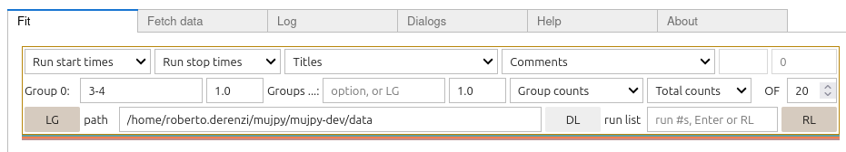
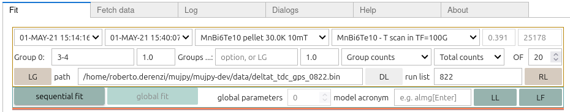
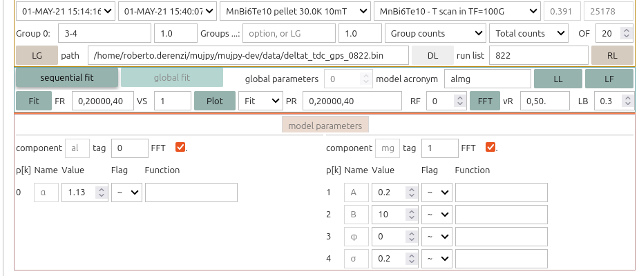

.. _Tutorial:

Tutorial
========
You installed `mujpy`. Find out below how to 
* run the simplest fit from the graphic interface
* explore the potential in the automatic demos

Basic GUI editor usage
----------------------
Get a GUI
~~~~~~~~~
* If you have access to lmu resources though hop.psi.ch, see below `A gui from PSI`_ 
* Linux:

  * activate the venv.  Choose the root of your data analysis, say ``mujpy/sample1``. Create subfolder ``data`` and download your data files in it. [1]_  
  * ``cd`` back to ``sample1`` and launch ``jupyter lab``. A tab opens in your default browser. 

* Windows: 

  * Choose the root of your data analysis in the Windows filesystem, say ``C:\Users\myhome\mujpy\sample1`` and place your data in subfolder ``data``. [1]_  
  * Start a Ubuntu terminal, activate the venv and ``cd`` to the Windows root folder,  ``/mnt/c/Users/myhome/mujpy`` (or ``mujpy/sample``). Launch ``jupyter lab --no-browser``. Copy one of the two urls that jupyterlab provides and paste it in a Windows browser. A tab 

Now launch a Python3 notebook. Write

.. code-block::

    %matplotlib qt

in the first cell (hover the green box for a code copy widget). This activates the `qt` backend for graphic popup windows, fine for smallish screens. If you prefer tabbed graphics type instead

.. code-blgTock::

    %matplotlib ipympl
    
Then move to the second cell and type

.. code-block::

        from mujpy.mudashed import dashed
        the_dash = dashed()
  
Rename this notebook, e.g. `Mudashed.ipynb`. From now on you can use this same notebook to run all your fits. 

Voila option
~~~~~~~~~~~~
Once you have this notebook you can also invoke it with `voila`. Create a tmp dir, for instance ``mkdir -p "$HOME/mujpy/tmp"``

.. code::

   export TMPDIR="$HOME/mujpy/tmp" 
   voila "$HOME/mujpy" # assumes mujpy as the root of mujpy analysis projects
   # chosen notebook must use widget (ipympl) backend, qt fails with voila

A tab with the gui opens in your browser. [1]_

.. [1] Voilà may miss error messages due to untracked bugs, try out on juypiterlab or notebook before reporting unexpected behavior

.. _dashed-tutorial:

Use it
~~~~~~
Assume you are running an :math:`\alpha` calibration in TF geometry, e.g. gps run 822, 2021.
Click on the first cell and press twice :math:`\blacktriangleright` in the notebook bar. Each time you want to restart from scratch `Mudashed` do the same). Three rows of widgets appear 

You can now retrieve run 822 from the Fetch data tab. 
Check that Group 0 is OK for you (it is, for 822). Then press DL and choose a prototype data file. Now type the run number (no leading zeros) in the run list box and press Enter. A new row of widgets appears. New info has appeared in the fist two widget rows, explore them. Notice that most widgets have tips shown when the mouse hovers on them (with browser in focus!).
 

Type your chosen model acronym in the box, e.g. ``almg``, calibrate :math:`\alpha`, and press ``Enter``. The model editor appears. 

* Component `al`, on the left side has one parameter :math:`\alpha`. Select a guess value, say 1.0. Forget Flag and Function, for now. 
* `mg` is a precessing component with Gaussian damping. Parameter names are self evident, `B` is mT, :math:`\phi` degrees. The figure has easonable guess values. Chech the FR box, fit range and binning, and press Fit to get your minimization. 

The gui switched to the log tab to show a printed log and a plot appeared. Notice that one `mg` component is not good enough, explore the plot and the log! Read below and see :ref:`Reference` for more details on the model editor (but be patient, it's WIP!)

.. [1] If you do not, the GUI creates the ``data`` subfolder in your `mujpy` root folder and it can directly download any PSI datafiles into it.

.. _demos:

Automatic demos
---------------
If you want to explore further `mujpy` potentials open an Ubuntu terminal, activate the venv, move to a suitable empty folder (e.g. `cd /tmp`) and run

.. code::

       python -m mujpy.tests.tests
  
The tests automatically produce 16 distinct types of `mujpy` fits on a standard gps TF experiment (runs 822-834). The model chosen is the sum of two relaxing cosines, a Gaussian component, `mg`, and a Lorentzian component `ml`, identified by the model acronym: `mgml`.  Follow below to understand their features:

* A plot opened: you see a TF asymmetry with its fit. Check the note below, and kill the window when done.

.. note::

        This is a simple A0 fit. Additional helpers catch goodness of fit: the residues, lower panel, an info box, top right, and :math:`\chi^2` histogram of the fit standard deviations, with the expectation curve, bottom right. More details in the terminal output. All the information is stored in log (ASCII), csv and json format, for plotting and reproducibility. When you kill the plot you also get a test summary.

* Another plot opened: same scenario, the A20 fit. Two orthogonal groups of detectors have been independently fitted. The log reports two reduced :math:`\chi^2` values.
 
.. note::
        This is an animation: you see both fits, in an infinite loop. Click on the plot to toggle stop/start. The terminal shows two compact logs (replicated in subfolder `cache/`): uniquely named parameters and their best values are also added to a specific csv (subfolder `csv/`). More details elsewhere in these docs.

* B1 fit: 4 independent A1 fits on a list of runs. Approaching a phase transition below 12.0 K

.. note::
        The animation loops on four independent fits. Actually the :math:`\chi^2` is not very good at 12.0K, something else is going on...

* B20 fit: 8 independent A20 fits on the same list of runs. Discover in which order from the plot and check on the log.
* A21 global fit: same run and groups as A20, but a single cost function. Log lists the best values of the Minuit parameters (f,A34,A21 etc) before the usual componet parameters, derived from them (here, a few details are hidden ...).
* B21 global fits: 4 independent A21 fits for the list of runs. Check.
* C1 global fit: list of 4 runs, only one group. Check that there is a single reduced :math:`\chi^2` and list of Minuit parameters. The log shows also the components for each asymmetry (for each run).

.. note::
        Each frame of the animation reports estimated :math:`\chi^2` statistics for that asymmetry, in the info box. The only true reduced :math:`\chi^2` is in the log.

* C2 global fit, the full Monthy. A single cost funtion for 2 groups and 4 runs. 

But there are further 8 fits. The previous ones had fixed :math:`\alpha` ratios (calibrated somehow). The next ones, model `almgml`, include :math:`\alpha` as a fit parameter for each group, in the very same sequence. Component `al` is listed with the others but it's not additive, it's treated differently.  That's how :math:`\alpha` is calibrated. With A20, B1, B20 fits you get calibrations for each asymmetry, with C1, C2 fits you get a single value per group (be it the correct one or some average if conditions change!). 

Now you can also re-run each test on its own. List them pasting 

.. code::

        python -c "from mujpy.tests.tests import ParameterizedRunner as PR; rnr=PR(); rnr.list_tests()"
        
in the terminal. Execute e.g. test 0 (A1 almgml) by 

.. code::

        python -c "from mujpy.tests.tests import ParameterizedRunner as PR; rnr=PR(); rnr.test_single(index=0)"

.. warning::
        the test timings includes your watch time on the plot! It is not very significant.

Instructions for `mujpy` on a PSI host will follow

..
        A gui from PSI
        --------------
        At PSI
        ~~~~~~

        If you have the following:

        * updated credentials on PSI linux hosts, say with user `ext-fmly_f`
        * `nemu` credentials (ask your local contact at PSI)

        Connect to `pc16885` from any lmu machine with `nemu` credentials, open an xterm and type (line by line, edit according to comments) 

        .. code::

           source ./mujpy-env-312/bin/activate
           mkdir mygroup # use your group name 
           cd mygroup 
           mkdir myproject # e.g. sample family name
           cd myproject
           jupyter lab

        Leave the xterm for the (long) jupyter lab log. A browser tab will open withe the jupyter lab dashboard. Operate from that according to `Use it`_ instructions.

        Outside PSI
        ~~~~~~~~~~~
        You can work from your laptop if you additionally have

        * a PSI accepted 2-step Authenticator
        * ssh on your laptop 

        Then you can add this snippet to your .ssh/config

        .. code::

               ControlMaster auto
               ControlPath ~/.ssh/tmp/%h_%p_%r
               Protocol 2
               ForwardX11 yes
               ForwardX11Trusted yes
               ForwardAgent yes
               host hop hopx.psi.ch
                hostname hopx.psi.ch
                user ext-fmly_f
                DynamicForward 8118
               host mujpy
                hostname pc16885.psi.ch
                user nemu
                ProxyJump hop
                LocalForward 127.0.0.1:8890 127.0.0.1:8888
                ExitOnForwardFailure yes 

        From a terminal in your laptop

        * ``ssh hop``, use your `ext-fmly_f` password, confirm by two-step authentication, and leave the terminal open
        * ``ssh mujpy``, use `nemu` password, and repeat these commands. Notice, when the ssh session times out (8 hours) restart the whole procedure. The jupyter lab command is replaced by

        .. code::

           jupyter lab --no-browser --ip=127.0.0.1 --port=8888
          
        The browser does not open on the PSI machine. In the PSI terminal log, last screen, find two successive lines: 

        * `[I 20yy-mm-dd hh:mm:ss.mil ServerApp] Jupyter Server 2.21.1 is running at:`
        * same prompt and the url `http://127.0.0.1:8888/lab?token=` with a very long hexadecimal word. 
          
        Copy the url, carefully including the hexadecimal

        * go to your favourite browser, open a tab and paste the url (without Enter!) 
        * correct the port in the url `:8888` to `8890` and then press Enter. 
          
        You get the PSI jupyter dashboard and you can `Use it`_!

        voila outside PSI
        ~~~~~~~~~~~~~~~~~

        See `Voila option`_ changing the ``voila Mudashed.ipynb`` command into

        .. code::

               voila "$HOME/mujpy" \
                --no-browser --Voila.ip=127.0.0.1 --port=8888 \
                --Voila.port_retries=0

              

  
